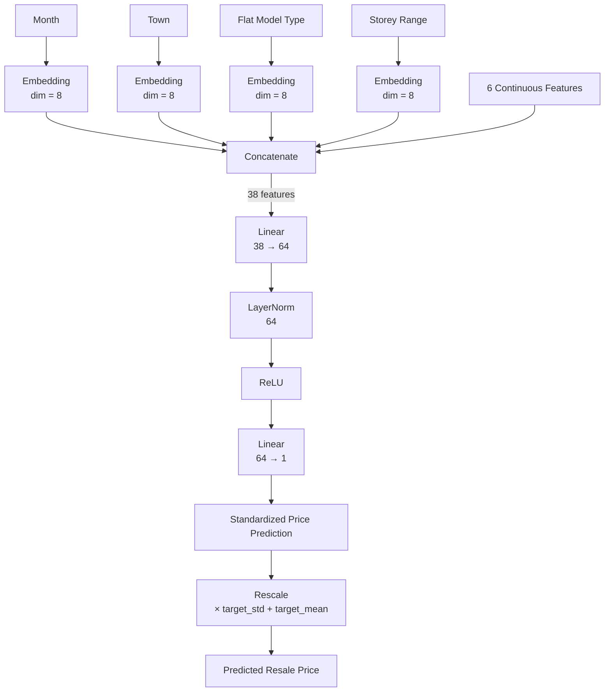

# neural-networks-assignment
## How to run Part A
`cd hdb-price-prediction-assignment/src`\
A1: run `python a1_tune.py` to completion before running `python a1_final_train.py`\
A2: run `python a2_ablation.py`\
A3: run `python a3_wide_deep.py`\
A4: run `python a4_feature_ablation.py`
## How to run Part B
`cd CNN/src`\
B1: run `python b1_train.py`\
B2: run `python b2_train.py`\
B3: run `python b3_train.py` to completion before running `python b3_compare.py`
B4: run `python b4_grad_cam.py`
## A1 
### Baseline Model Architecture

### Baseline Parameter Count
The baseline model has **3,505 trainable parameters**.
#### Embedding Layers
The four categorical features have cardinalities of 13, 27, 44, and 18, with an embedding dimension of 8 for each feature.
`13(8) + 27(8) + 44(8) + 18(8)`
`= 104 + 216 + 352 + 144`
`= 816`
#### First Linear Layer
The four 8-dimensional embeddings produce 32 features. Together with the 6 continuous features, the input dimension is 38.
The first linear layer maps 38 inputs to 64 hidden units:
`38(64) + 64 = 2496`
where 38x64 represent 38 weight parameters for each sample multiplied by input width 64, and 64 additional bias parameters.
#### Layer Normalization
Layer normalization contains one learnable scale and one learnable bias for each of the 64 hidden units:
`64 + 64 = 128`
#### Output Layer
The output layer maps the 64 hidden units to one output with 64 weight parameters:
`64(1) + 1 = 65`
### Total Trainable Parameters
`816 + 2496 + 128 + 65 = 3505`
### Hyperparameter Optimisation
BEST CONFIGURATION:\
Hidden width: 128\
Embedding dimension: 12\
Best validation RMSE: 59,766.91

    Hidden    Embedding      Best Val RMSE
       128           12          59,766.91
       256            2          59,926.48
       256            4          61,435.03
       128            4          61,977.41
       256           16          61,999.66
        32           12          62,479.79
        16           12          62,654.96
        32            4          62,886.20
        64           16          63,032.88
        64            8          63,422.46
        64            2          63,491.59
       256            8          63,806.88
        64           12          64,105.07
        32           16          64,593.14
        64            4          64,633.77
       256           12          65,072.00
       128           16          65,599.97
        32            8          66,199.89
       128            2          66,327.64
        16            2          66,425.56
       128            8          66,832.43
        16           16          67,164.91
        16            8          67,520.02
        16            4          68,879.52
        32            2          69,203.99
### Training and Validation RMSE

### Retrain model on combined train and validation sets:

    epoch 01 | train RMSE 44,383.07 | test RMSE 107,977.41
    epoch 02 | train RMSE 43,615.70 | test RMSE 93,158.23
    epoch 03 | train RMSE 40,706.75 | test RMSE 104,607.33
    epoch 04 | train RMSE 40,913.82 | test RMSE 97,495.47
    epoch 05 | train RMSE 39,331.23 | test RMSE 99,816.12
    epoch 06 | train RMSE 39,456.30 | test RMSE 104,240.83
    epoch 07 | train RMSE 39,469.28 | test RMSE 105,467.51
    epoch 08 | train RMSE 39,193.23 | test RMSE 99,124.45
    epoch 09 | train RMSE 38,682.61 | test RMSE 100,854.71
    epoch 10 | train RMSE 39,392.42 | test RMSE 92,690.02
    epoch 11 | train RMSE 39,049.87 | test RMSE 92,375.76
    epoch 12 | train RMSE 38,113.98 | test RMSE 102,521.88
    epoch 13 | train RMSE 38,359.75 | test RMSE 91,237.82
FINAL RESULTS\
Hidden width: 128\
Embedding dimension: 12\
Epochs: 13\
Test RMSE: 91,237.82\
Test R²: 0.7128
### Discussion of Model Performance:
The final model used a hidden-layer width of 128 and an embedding dimension of 12, selected based on validation performance during hyperparameter tuning. The model was retrained for 13 epochs (based on lowest validation RMSE during the initial training) using the combined training and validation data from 2017–2021 and evaluated on the unseen 2022 test data.

The training RMSE generally decreased from 44,383.07 SGD at epoch 1 to 38,359.75 SGD at epoch 13, indicating that the model continued to fit the training data as training progressed. In comparison, the test RMSE was substantially higher and fluctuated considerably between epochs. The final model achieved a test RMSE of 91,237.82 SGD and an R^2 score of 0.7128. The R^2 value indicates that the model explains approximately 71.3% of the variation in 2022 resale prices.

The large difference between training and test RMSE may indicate some degree of overfitting. However, the model was trained using transactions up to 2021 and tested exclusively on transactions from 2022. Changes in HDB resale prices and market conditions between these periods can cause the test distribution to differ from the training distribution. Therefore, the higher test error is likely attributable to a combination of model overfitting and temporal distribution shift, rather than overfitting alone.

There is little evidence of substantial underfitting. Although the training RMSE is still decreasing toward the end of training, suggesting that the model has not fully converged and could potentially improve with additional epochs, it already achieves a relatively low training error. The test RMSE and R² further indicate that the learned relationship generalises reasonably well to unseen data. Therefore, the continuing decrease in training RMSE is better interpreted as incomplete convergence rather than strong evidence of insufficient model capacity

## A2
### Ablation experiment results:

    ==============================
    Baseline
    ==============================
    seed 1 | RMSE 108,553.18 | R² 0.5935
    seed 2 | RMSE 95,140.68 | R² 0.6877
    seed 3 | RMSE 98,216.47 | R² 0.6672
    seed 4 | RMSE 99,383.36 | R² 0.6593
    seed 5 | RMSE 94,572.52 | R² 0.6915

    ==============================
    No Embeddings
    ==============================
    seed 1 | RMSE 110,278.54 | R² 0.5805
    seed 2 | RMSE 114,545.95 | R² 0.5474
    seed 3 | RMSE 118,275.66 | R² 0.5174
    seed 4 | RMSE 109,010.13 | R² 0.5901
    seed 5 | RMSE 107,334.84 | R² 0.6026

    ==============================
    Sigmoid
    ==============================
    seed 1 | RMSE 100,191.81 | R² 0.6537
    seed 2 | RMSE 102,692.04 | R² 0.6362
    seed 3 | RMSE 101,286.34 | R² 0.6461
    seed 4 | RMSE 94,755.66 | R² 0.6903
    seed 5 | RMSE 84,489.90 | R² 0.7537

    ==============================
    ABLATION SUMMARY
    ==============================
            model    mean_rmse   std_rmse  mean_r2  std_r2
        Baseline  99,173.2406 5,620.7437   0.6598  0.0395
    No Embeddings 111,889.0250 4,457.3152   0.5676  0.0347
        Sigmoid  96,683.1500 7,449.7880   0.6760  0.0480

### Discussion of ablation experiments:
The ablation experiments demonstrate that the categorical embeddings make an important contribution to predictive performance. The baseline model achieved a mean test RMSE of SGD 99,173 ± 5,621 and mean R^2 of 0.6598 ± 0.0395 across five seeds. Removing all categorical embeddings increased the mean RMSE to SGD 111,889 ± 4,457 and reduced mean R^2 to 0.5676 ± 0.0347. This corresponds to an approximately 12.8% increase in RMSE, indicating that the categorical variables provide substantial predictive information beyond that contained in the six continuous features.

Replacing ReLU with Sigmoid produced a smaller and less conclusive change. The Sigmoid model achieved the lowest mean RMSE of SGD 96,683 ± 7,450 and highest mean R^2 of 0.6760 ± 0.0480. This represents an approximately 2.5% reduction in mean RMSE relative to the ReLU baseline. However, the Sigmoid model also exhibited the largest standard deviation across seeds, indicating greater sensitivity to random initialisation. Therefore, the results do not demonstrate an advantage of ReLU over Sigmoid for this task; rather, both activations perform comparably, with Sigmoid achieving slightly better average performance but lower consistency.

Overall, the experiments indicate that feature representation has a considerably greater effect than the choice between ReLU and Sigmoid activation. Removing categorical embeddings substantially degraded performance across all five seeds, whereas changing the activation function caused only a relatively small change in average performance.

## A3
### Wide and Deep results:
    ==============================
    LAMBDA SEARCH
    ==============================
    lambda    0 | validation RMSE 62,553.89
    lambda 0.25 | validation RMSE 61,050.42
    lambda  0.5 | validation RMSE 61,499.38
    lambda    1 | validation RMSE 61,479.33
    lambda    2 | validation RMSE 58,170.70

    Best lambda: 2.0

    ==============================
    FIVE-SEED EVALUATION
    ==============================
    seed 1 | RMSE 94,824.51 | R² 0.6898
    seed 2 | RMSE 91,874.73 | R² 0.7088
    seed 3 | RMSE 98,780.30 | R² 0.6634
    seed 4 | RMSE 92,375.70 | R² 0.7056
    seed 5 | RMSE 99,291.86 | R² 0.6599

    ==============================
    FINAL WIDE-AND-DEEP RESULTS
    ==============================
    Lambda: 2.0
    Test RMSE: 95,429.42 ± 3,481.15
    Test R²: 0.6855 ± 0.0230

### Discussion:
The lambda search identified \lambda=2 as the optimal value achieving the lowest validation RMSE of SGD 58,170.70. In comparison, \lambda=0, which removes the contribution of the linear branch from the prediction, produced a validation RMSE of SGD 62,553.89. This provides evidence that incorporating the linear branch improves generalisation.

Using \lambda=2, the wide-and-deep model achieved a mean test RMSE of SGD 95,429 ± 3,481 and mean R^2 of 0.6855 ± 0.0230 across five seeds. The corresponding five-seed A1 baseline achieved SGD 99,173 ± 5,621 and R^2=0.6598\pm0.0395. Thus, the wide-and-deep architecture reduced mean RMSE by approximately 3.8% while also producing lower variation across random seeds.

A possible mechanism is that the parallel linear branch provides a direct representation of additive relationships between the input features and resale price, while the MLP branch models nonlinear relationships and feature interactions. 

(Limitation) However, adding the linear branch increases the model’s number of trainable parameters, so some of the improvement may result from increased model capacity rather than specifically from the decomposition into linear and nonlinear components. 
## A4
### Captum FeatureAblation results
    ==============================
    A1 Baseline
    ==============================
    flat_model_type           $   57,545.57
    floor_area_sqm            $   56,733.25
    town                      $   48,265.39
    remaining_lease_years     $   41,323.88
    dist_to_dhoby             $   35,782.34
    storey_range              $   24,972.46
    dist_to_nearest_stn       $   21,373.50
    month                     $   15,417.76
    eigenvector_centrality    $    5,989.59
    degree_centrality         $    3,295.08

    Top 3:
    1. flat_model_type ($57,545.57)
    2. floor_area_sqm ($56,733.25)
    3. town ($48,265.39)

    ==============================
    A3 Wide-and-Deep
    ==============================
    flat_model_type           $   66,390.06
    floor_area_sqm            $   57,648.34
    town                      $   42,768.50
    remaining_lease_years     $   42,661.44
    dist_to_dhoby             $   33,096.89
    storey_range              $   31,450.37
    month                     $   22,669.65
    dist_to_nearest_stn       $   19,513.39
    eigenvector_centrality    $    6,244.37
    degree_centrality         $    4,233.68

    Top 3:
    1. flat_model_type ($66,390.06)
    2. floor_area_sqm ($57,648.34)
    3. town ($42,768.50)

Feature ablation produced highly similar feature-importance rankings for the A1 baseline and A3 wide-and-deep models. For both models, the three most important features were flat_model_type, floor_area_sqm, and town. In the baseline, their mean absolute attributions were SGD 57,545.57, SGD 56,733.25, and SGD 48,265.39 respectively. For the wide-and-deep model, the corresponding values were SGD 66,390.06, SGD 57,648.34, and SGD 42,768.50.

The similarity of the rankings indicates that the addition of the linear branch did not substantially alter which input features the model relies upon most. The ordering of eight of the ten features remained identical. 

However, attribution magnitudes changed for several features. For example, the importance of flat_model_type increased from approximately SGD 57.5k to SGD 66.4k, while the importance of town decreased from SGD 48.3k to SGD 42.8k, suggesting that how predictive influence is distributed among features has changed.

The results are also consistent with the A2 ablation experiment, where removing the categorical embeddings degraded predictive performance. Two of the three highest-ranked features, flat_model_type and town, are categorical.

One limitation of FeatureAblation is that the resulting importance scores depend on the chosen baseline. Continuous features were replaced by their training mean, while categorical features were replaced by the unknown-category value. Different baselines could therefore result in different attribution magnitudes and feature rankings.

## B1: AlexNet-like CNN
### Learning Rate Selection

    | Learning Rate | Best Epoch | Validation Loss | Classification Error | Sensitivity | Specificity |
    |---|---:|---:|---:|---:|---:|
    | 1e-5 | 50 | 0.1601 | 0.0592 | 0.9614 | 0.8815 |
    | 1e-4 | 36 | 0.0649 | 0.0191 | 0.9820 | 0.9778 |
    | **1e-3** | **50** | **0.1191** | **0.0134** | **0.9897** | **0.9778** |
    | 1e-2 | 29 | 0.0854 | 0.0153 | 0.9923 | 0.9630 |
    | 1e-1 | 31 | 0.1028 | 0.0248 | 0.9794 | 0.9630 |

The optimal learning rate was **1e-3**, which achieved the lowest validation
classification error of **0.0134**.

### Discussion
The curves show that **1e-5 converges slowly**, while 1e-4 and 1e-3 converge
considerably faster. **1e-3 achieved the best validation accuracy**, whereas
the larger learning rates 1e-2 and 1e-1 showed greater fluctuations,
indicating less stable convergence.

Sensitivity and specificity are required in addition to accuracy because
accuracy can hide differences in performance between the two classes.
Sensitivity measures correct detection of positive cases, while specificity
measures correct detection of negative cases.
### Test Results
    | Metric | Result |
    |---|---:|
    | Accuracy | **85.42%** |
    | Sensitivity | **99.49%** |
    | Specificity | **61.97%** |
The high sensitivity but substantially lower specificity shows that the
model performs very differently across the two classes, which would not be
apparent from accuracy alone.
## B2: VGG-like CNN
### Batch Size Selection
The best learning rate from B1, **1e-3**, was used for all experiments.
    | Batch Size | Best Epoch | Validation Loss | Classification Error | Sensitivity | Specificity |
    |---:|---:|---:|---:|---:|---:|
    | 16 | 12 | 0.0595 | 0.0191 | 0.9820 | 0.9778 |
    | **32** | **42** | **0.0696** | **0.0172** | **0.9897** | **0.9630** |
    | 64 | 27 | 0.0710 | 0.0210 | 0.9897 | 0.9481 |
    | 128 | 30 | 0.0792 | 0.0229 | 0.9846 | 0.9556 |
    | 256 | 47 | 0.0698 | 0.0248 | 0.9923 | 0.9259 |
The optimal batch size was **32**, which achieved the lowest validation
classification error of **0.0172** (98.28% validation accuracy).

### Discussion
Batch size **32** achieved the lowest validation classification error. Smaller batch sizes generally reached strong validation performance earlier. Increasing the batch size beyond
32 did not improve validation classification error.
### Test Results
    | Metric | Result |
    |---|---:|
    | Accuracy | **89.74%** |
    | Sensitivity | **99.49%** |
    | Specificity | **73.50%** |
The final model maintained very high sensitivity but lower specificity,
indicating better detection of positive cases than negative
cases.
## B3: ResNet-like CNN
The ResNet-like model was trained using the optimal learning rate of **1e-3**
from B1 and batch size of **32** from B2.
The best validation performance occurred at epoch **10**, with a validation
accuracy of **97.71%** and classification error of **2.29%**.
### Test Results
    | Metric | Result |
    |---|---:|
    | Accuracy | **87.34%** |
    | Sensitivity | **99.49%** |
    | Specificity | **67.09%** |
    | Classification Error | **12.66%** |
### Architecture Comparison
FLOPs are computed assuming one multiply-accumulate (MAC) corresponds to two
floating-point operations
    | Architecture | Accuracy | Sensitivity | Specificity | Classification Error | Learnable Parameters | FLOPs |
    |---|---:|---:|---:|---:|---:|---:|
    | B1 AlexNet-like | 85.42% | 99.49% | 61.97% | 14.58% | 99,569 | 39,991,360 |
    | **B2 VGG-like** | **89.74%** | **99.49%** | **73.50%** | **10.26%** | **18,185** | **20,385,920** |
    | B3 ResNet-like | 87.34% | 99.49% | 67.09% | 12.66% | 77,169 | 26,386,688 |
### Comparison
The **VGG-like model (B2)** performed best, achieving the highest accuracy
(89.74%) and specificity (73.50%) while maintaining the same high sensitivity
(99.49%) as B1 and B3. It was also the most computationally efficient, using
only **18,185 parameters** and **20.39 million FLOPs**.

The AlexNet-like model has the largest parameter count and computational cost
mainly due to its larger convolution kernels and fully connected layers. Its
advantage is a simple architecture, but it achieved the lowest accuracy and
specificity.

The VGG-like model uses repeated small 3x3 convolutions and global average
pooling, giving it the fewest parameters and FLOPs while achieving the best
test performance. Its disadvantage is that its deeper sequential structure
does not provide residual connections.

The ResNet-like model uses skip connections, which provide alternative paths
for information and gradients and can make deeper networks easier to train.
However, for this relatively small problem, the additional residual structure
did not improve performance over B2 and increased both parameter count and
FLOPs.
## B4: Grad-CAM Analysis
Five pneumonia X-rays were randomly selected from the test set using a fixed
random seed. Grad-cAM was applied to the final convolutional layer of each
architecture, and the resulting activation maps were overlaid on the original
X-rays.

### Comparison
The Grad-CAM visualisations show that the three architectures rely on different
spatial regions when predicting pneumonia.
- **B1 (AlexNet-like)** generally produces compact, concentrated activation
  regions, frequently around the central/lower chest
- **B2 (VGG-like)** produces smaller and more scattered activation regions
  across the images
- **B3 (ResNet-like)** produces broader activation regions covering larger
  portions of the chest

All three models predict the selected pneumonia cases with high confidence,
but their Grad-CAM maps do not consistently highlight the same regions.
Furthermore, some strong activations occur near image boundaries or central
anatomical structures rather than clearly corresponding to visible cloudy
lung patches.

Therefore, while Grad-CAM indicates which image regions influence each
model's prediction, these results do not provide strong evidence that the
models consistently identify the clinically relevant regions containing pneumonia patches.