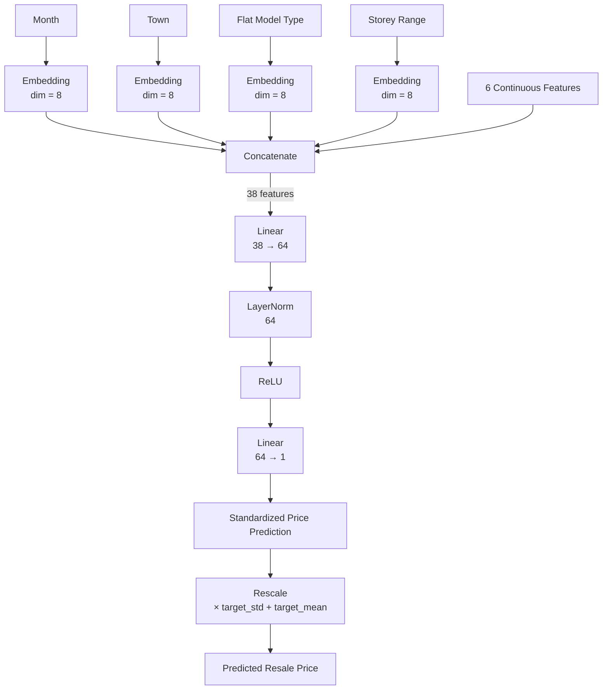

# neural-networks-assignment
## A1
### Baseline Model Architecture

### Baseline Parameter Count
The baseline model has **3,505 trainable parameters**.
#### Embedding Layers
The four categorical features have cardinalities of 13, 27, 44, and 18, with an embedding dimension of 8 for each feature.
`13(8) + 27(8) + 44(8) + 18(8)`
`= 104 + 216 + 352 + 144`
`= 816`
#### First Linear Layer
The four 8-dimensional embeddings produce 32 features. Together with the 6 continuous features, the input dimension is 38.
The first linear layer maps 38 inputs to 64 hidden units:
`38(64) + 64 = 2496`
where 38x64 represent 38 weight parameters for each sample multiplied by input width 64, and 64 additional bias parameters.
#### Layer Normalization
Layer normalization contains one learnable scale and one learnable bias for each of the 64 hidden units:
`64 + 64 = 128`
#### Output Layer
The output layer maps the 64 hidden units to one output with 64 weight parameters:
`64(1) + 1 = 65`
### Total Trainable Parameters
`816 + 2496 + 128 + 65 = 3505`
### Hyperparameter Optimisation
==============================
BEST CONFIGURATION
==============================
Hidden width: 128
Embedding dimension: 12
Best validation RMSE: 59,766.91

==============================
ALL RESULTS
==============================
    Hidden    Embedding      Best Val RMSE
       128           12          59,766.91
       256            2          59,926.48
       256            4          61,435.03
       128            4          61,977.41
       256           16          61,999.66
        32           12          62,479.79
        16           12          62,654.96
        32            4          62,886.20
        64           16          63,032.88
        64            8          63,422.46
        64            2          63,491.59
       256            8          63,806.88
        64           12          64,105.07
        32           16          64,593.14
        64            4          64,633.77
       256           12          65,072.00
       128           16          65,599.97
        32            8          66,199.89
       128            2          66,327.64
        16            2          66,425.56
       128            8          66,832.43
        16           16          67,164.91
        16            8          67,520.02
        16            4          68,879.52
        32            2          69,203.99
### Training and Validation RMSE

